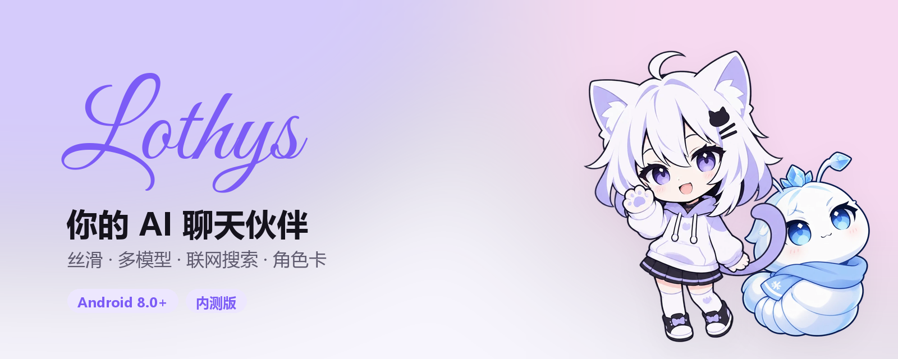
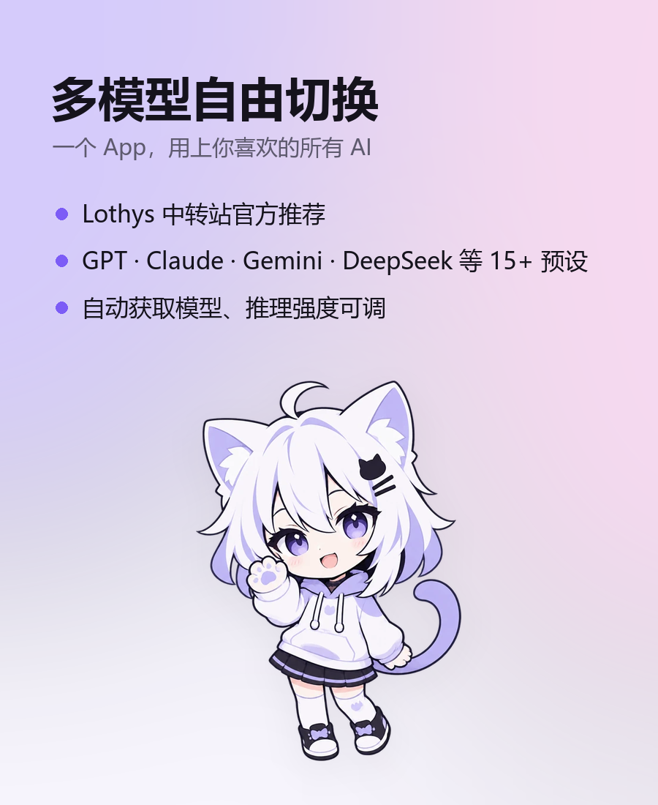
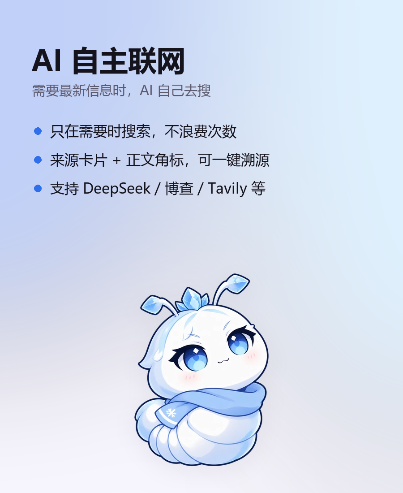
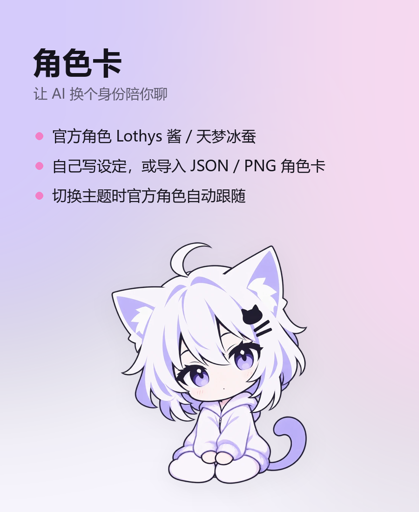
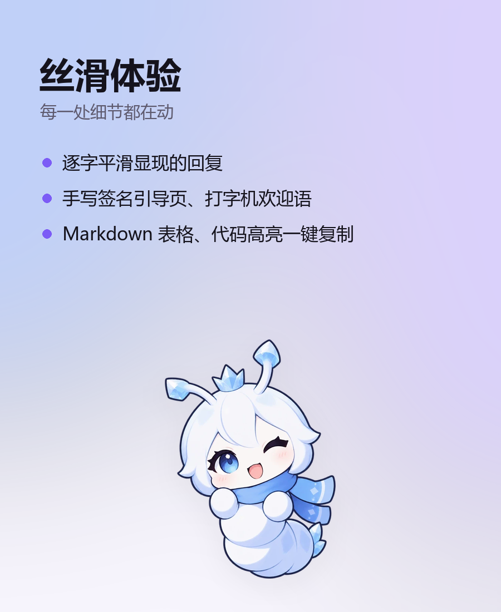
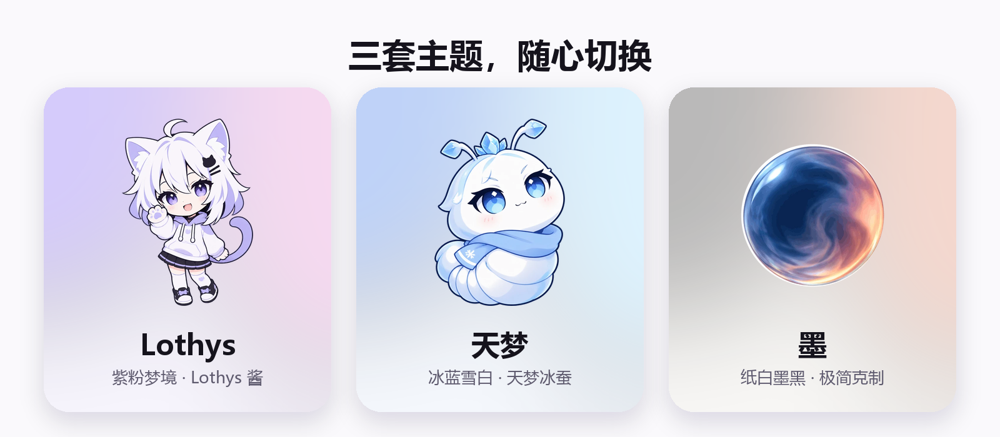

  

  <b>Lothys —— 你的 AI 聊天伙伴</b> 
  丝滑 · 多模型 · AI 自主联网 · 角色卡

  <a href="../../releases/latest"><b>⬇️ 下载最新版</b></a>
  &nbsp;·&nbsp;
  <a href="https://7891.gay">Lothys 中转站</a>
  &nbsp;·&nbsp;
  QQ 群 1018972350

---

> 📢 **内测版**：Lothys 正在积极开发中，可能会遇到一些实验性问题，欢迎进群反馈。
> 本仓库只用于发布安装包和更新说明，**不包含源代码**。

## 下载安装

1. 打开 [Releases](../../releases/latest)，下载最新的 `Lothys-x.x.x.apk`
2. 在手机上打开安装包。如果提示"禁止安装未知来源应用"，按提示在设置里允许一次即可
3. 打开 App，注册 / 登录后跟着引导完成设置

**系统要求**：Android 8.0 及以上

更新时直接下载新版本覆盖安装，聊天记录和设置都会保留。

## 功能

<table>
  <tr>
    <td width="50%"></td>
    <td width="50%"></td>
  </tr>
  <tr>
    <td width="50%"></td>
    <td width="50%"></td>
  </tr>
</table>

- **多模型**：内置 Lothys 中转站（官方推荐）以及 OpenAI、Claude、Gemini、DeepSeek、通义千问、智谱、Kimi、豆包等 15+ 预设，也支持任意 OpenAI 兼容接口；自动获取模型列表，推理强度可调
- **AI 自主联网**：开启后由 AI 判断是否需要搜索，回答带来源卡片和角标，可一键打开原网页
- **角色卡**：官方角色 Lothys 酱 / 天梦冰蚕，也可以自己写，或导入通用 JSON / PNG 角色卡
- **图片与文件**：拍照、相册、文档（文本、代码、Markdown、Word 等）直接发给模型
- **思考过程**：支持推理模型的思维链，按小标题逐段展示
- **Markdown**：表格、代码高亮、一键复制
- **记忆与个性化**：自定义称呼、语气、回复风格

## 主题

## 隐私

- 你添加的模型密钥、联网搜索密钥**只保存在你的手机上**，用于直接请求对应服务
- 账号登录凭证使用系统安全模块加密保存，不参与系统备份
- 聊天记录保存在本机

## 反馈

- QQ 群：**1018972350**
- 也可以在本仓库的 [Issues](../../issues) 里提交问题

---

© Lothys. 保留所有权利。本仓库仅分发安装包，不授予源代码的使用许可。

